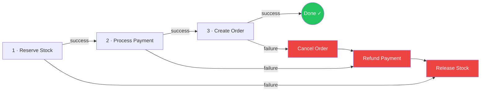
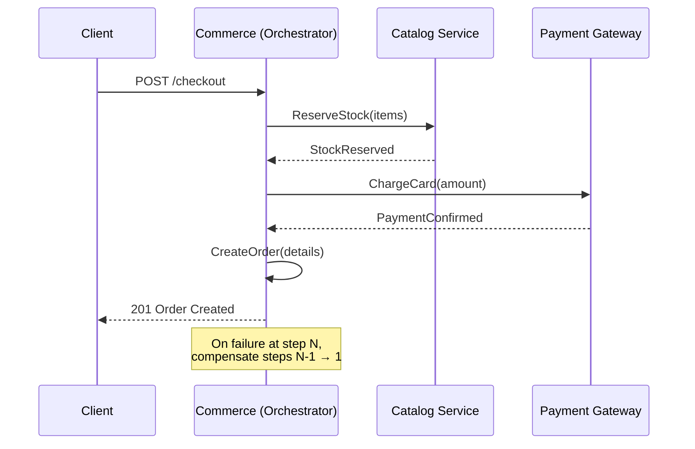

# ADR-002: Use Saga Pattern (Orchestration) over Two-Phase Commit for Checkout

| Field      | Value                |
|------------|----------------------|
| **Status** | Accepted             |
| **Date**   | 2026-09-28           |
| **Scope**  | Commerce Service     |

## Context

The checkout flow spans multiple microservices and bounded contexts:

1. **Catalog Service** — reserve stock for the requested items.
2. **Commerce Service** — process payment via the payment gateway.
3. **Commerce Service** — create the order record and transition it to `CONFIRMED`.

A failure at any step must roll back the effects of all preceding steps. We need a distributed transaction strategy that is reliable, scalable, and practical for a solo-developer project.

## Decision

**Use an orchestrator-based Saga inside the Commerce service** rather than a Two-Phase Commit (2PC) protocol.

The Commerce service acts as the **saga orchestrator**: it drives the sequence of steps, listens for success/failure of each, and triggers compensating transactions on failure.

## Saga Steps

| Step | Action            | Compensating Action | Service          |
|------|-------------------|---------------------|------------------|
| 1    | Reserve stock     | Release stock       | Catalog (gRPC)   |
| 2    | Process payment   | Refund payment      | Commerce         |
| 3    | Create order      | Cancel order        | Commerce         |

### Orchestration Flow (sequence)

## Rationale

### Why not Two-Phase Commit (2PC)?

| Concern              | 2PC                                                    | Saga                                                  |
|----------------------|--------------------------------------------------------|-------------------------------------------------------|
| **Locking**          | Holds distributed locks across services during prepare | Each step is a local transaction — no cross-service locks |
| **Scalability**      | Coordinator is a single point of failure & bottleneck  | Orchestrator is just another service instance          |
| **Complexity**       | Requires XA-compatible data stores                     | Works with any data store                              |
| **Partial failure**  | Blocked participants if coordinator crashes             | Compensating transactions run independently            |
| **Industry fit**     | Designed for monolithic RDBMS clusters                  | Industry standard for microservice architectures       |

### Why Orchestration over Choreography?

- **Single service owns the workflow** — easier to reason about, debug, and visualize.
- **Explicit step ordering** — no implicit event chains to trace across services.
- **Centralized error handling** — the orchestrator knows exactly which compensations to fire.
- For a solo developer, orchestration is significantly easier to maintain than a choreography-based event mesh.

## Consequences

### Positive

- Each microservice only needs to implement its local transaction and its compensating action.
- The saga state can be persisted (e.g., in a `saga_executions` table) for observability and replay.
- Scales horizontally — multiple Commerce instances can orchestrate independent sagas.

### Negative

- **Eventual consistency** — there is a brief window where stock is reserved but the order doesn't yet exist. Clients must handle `202 Accepted` / polling patterns.
- **Compensating transactions must be idempotent** — network retries may invoke the same compensation multiple times.
- **Partial failure UX** — users may see transient states (e.g., payment charged but order not yet visible). Notification service should communicate progress.

### Mitigations

- Every saga step is idempotent (keyed by a unique `saga_id`).
- Saga state is persisted to PostgreSQL so it survives orchestrator restarts.
- A background reconciler detects "stuck" sagas (no progress for > 5 minutes) and triggers compensations automatically.
