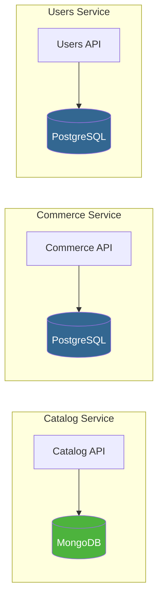

# ADR-003: Use MongoDB for Catalog Service, PostgreSQL for Commerce & Users

| Field      | Value                            |
|------------|----------------------------------|
| **Status** | Accepted                         |
| **Date**   | 2026-09-28                       |
| **Scope**  | Catalog, Commerce, Users Services |

## Context

The platform requires at least one SQL and one NoSQL database to demonstrate polyglot persistence. Different services have fundamentally different data-modelling needs:

- **Products** have highly variable attributes — electronics have specs (CPU, RAM, screen size), clothing has sizes and colors, books have ISBNs and page counts. A rigid relational schema would require an impractical EAV (Entity-Attribute-Value) pattern or constant migrations.
- **Orders, payments, and stock** are inherently transactional — they demand ACID guarantees, row-level locking, and referential integrity.
- **Users and authentication** fit a well-defined, stable schema with strong consistency requirements.

## Decision

| Service     | Database   | Rationale                                |
|-------------|------------|------------------------------------------|
| **Catalog** | MongoDB    | Flexible document schema for products    |
| **Commerce**| PostgreSQL | ACID transactions for orders & payments  |
| **Users**   | PostgreSQL | Stable schema, strong consistency        |



## Rationale

### MongoDB for Catalog

| Benefit                        | Detail                                                                                     |
|--------------------------------|--------------------------------------------------------------------------------------------|
| **Flexible document schema**   | Each product category can have its own set of attributes without schema migrations.        |
| **Built-in text search**       | MongoDB text indexes (`$text`, `$search`) provide full-text search without Elasticsearch for MVP. |
| **Nested documents**           | Reviews, ratings, and variant options embed naturally as sub-documents.                    |
| **Aggregation pipeline**       | Powerful aggregation framework for faceted search, category counts, and analytics.         |

**Example product documents:**

```json
// Electronics
{
  "_id": "prod_001",
  "name": "Wireless Mouse",
  "category": "electronics",
  "price": 29.99,
  "attributes": {
    "dpi": 1600,
    "connectivity": "bluetooth",
    "battery_life_hours": 120
  },
  "seller_id": "user_042",
  "created_at": "2026-09-28T10:00:00Z"
}

// Clothing
{
  "_id": "prod_002",
  "name": "Cotton T-Shirt",
  "category": "clothing",
  "price": 19.99,
  "attributes": {
    "sizes": ["S", "M", "L", "XL"],
    "colors": ["black", "white", "navy"],
    "material": "100% cotton"
  },
  "seller_id": "user_077",
  "created_at": "2026-09-28T10:05:00Z"
}
```

### PostgreSQL for Commerce & Users

| Benefit                          | Detail                                                                                      |
|----------------------------------|---------------------------------------------------------------------------------------------|
| **ACID transactions**            | Checkout saga steps are local transactions — `BEGIN` / `COMMIT` / `ROLLBACK`.               |
| **Row-level locking**            | `SELECT ... FOR UPDATE` prevents overselling during concurrent stock reservations.          |
| **Referential integrity**        | Foreign keys enforce relationships between orders, order items, payments, and stock records. |
| **Mature migration tooling**     | `golang-migrate` or `goose` provide reliable, version-controlled schema migrations.         |
| **JSON columns when needed**     | PostgreSQL `jsonb` can store semi-structured data (e.g., order metadata) if needed.         |

**Key Commerce tables:**

```sql
-- Stock management with row-level locking
SELECT quantity FROM stock WHERE product_id = $1 FOR UPDATE;
UPDATE stock SET quantity = quantity - $2 WHERE product_id = $1;

-- Order with referential integrity
CREATE TABLE orders (
    id          UUID PRIMARY KEY DEFAULT gen_random_uuid(),
    user_id     UUID NOT NULL,
    status      VARCHAR(20) NOT NULL DEFAULT 'pending',
    total       DECIMAL(10,2) NOT NULL,
    created_at  TIMESTAMPTZ NOT NULL DEFAULT NOW()
);
```

## Consequences

### Positive

- Each service uses the database technology best suited to its domain.
- Demonstrates polyglot persistence — a valuable architectural pattern for the portfolio.
- MongoDB's schemaless nature accelerates iteration on the product model.
- PostgreSQL's guarantees eliminate an entire class of data-integrity bugs in the commerce domain.

### Negative

- **Two migration strategies** — MongoDB schema versioning (application-level or `mongosh` scripts) and PostgreSQL migrations (`golang-migrate`).
- **No cross-service JOINs** — enriching an order with product details requires an API call to the Catalog service. This is expected and correct in a microservices architecture, but adds latency.
- **Operational overhead** — two database engines to deploy, monitor, back up, and secure (mitigated by managed services or Docker Compose for local dev).

### Mitigations

- Use a shared `Makefile` target (`make migrate-all`) that runs both MongoDB and PostgreSQL migrations.
- Cache frequently-accessed product data (name, price, image URL) in the Commerce service's order items to reduce cross-service calls.
- Use Docker Compose for local development so both databases start with a single `docker compose up`.
