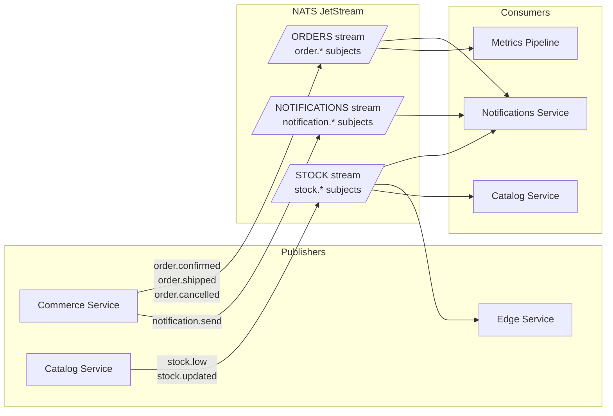

# ADR-004: Use NATS JetStream as the Internal Event Bus

| Field      | Value                     |
|------------|---------------------------|
| **Status** | Accepted                  |
| **Date**   | 2026-09-28                |
| **Scope**  | All services (platform)   |

## Context

Several workflows require asynchronous, event-driven communication between services:

- **Order state changes** — Commerce publishes `order.confirmed`, `order.shipped`, etc.; Notifications service reacts.
- **Stock alerts** — Catalog publishes `stock.low` when inventory drops below a threshold; Notifications and Edge services react.
- **Notification triggers** — any service can request a user notification (email, push, in-app) via a `notification.send` event.
- **Analytics ingestion** — events are consumed by the metrics pipeline for dashboards.

We need a messaging system that provides **persistence** (no lost messages if a consumer is temporarily down), **at-least-once or exactly-once delivery**, and **low operational complexity** for a solo developer.

## Decision

**Use NATS JetStream** as the internal event bus for all inter-service asynchronous communication.

## Alternatives Considered

| System             | Pros                                          | Cons                                                        | Verdict      |
|--------------------|-----------------------------------------------|-------------------------------------------------------------|--------------|
| **NATS JetStream** | Single binary (~15 MB), built-in persistence, exactly-once semantics, first-class Go SDK | Smaller ecosystem than Kafka                                | ✅ **Chosen** |
| **Redis Pub/Sub**  | Already in stack (caching), simple API        | **No persistence** — messages lost if consumer is offline   | ❌ Rejected   |
| **RabbitMQ**       | Mature, flexible routing (exchanges/queues)   | Heavier operational footprint, Erlang runtime, overkill     | ❌ Rejected   |
| **Apache Kafka**   | Industry standard for event streaming at scale | Significant operational complexity (ZooKeeper/KRaft, partitions, consumer groups) — overkill for portfolio scale | ❌ Rejected   |

## Rationale

### Why NATS JetStream?

1. **Lightweight deployment** — a single `nats-server` binary (~15 MB). No JVM, no Erlang, no ZooKeeper. Starts in milliseconds.

2. **JetStream persistence** — unlike core NATS (fire-and-forget), JetStream provides durable streams with configurable retention (by time, size, or message count). Messages survive consumer downtime.

3. **Exactly-once delivery** — JetStream supports exactly-once semantics via message deduplication (publish-side) and double-ack (consumer-side). Critical for payment and stock events.

4. **First-class Go support** — the official [`nats.go`](https://github.com/nats-io/nats.go) library is maintained by the NATS team. Idiomatic Go API with context support, structured logging, and native protobuf serialization.

5. **Consumer groups (queue groups)** — multiple instances of a service can form a queue group for load-balanced consumption, enabling horizontal scaling without code changes.

6. **Built-in monitoring** — NATS exposes a `/varz`, `/connz`, `/jsz` HTTP endpoint for metrics. Integrates cleanly with Prometheus via the NATS exporter.

### Event Topology



### Stream Configuration

| Stream            | Subjects            | Retention | Max Age | Replicas | Notes                              |
|-------------------|----------------------|-----------|---------|----------|------------------------------------|
| `ORDERS`          | `order.*`           | Limits    | 30 days | 1        | Order lifecycle events             |
| `STOCK`           | `stock.*`           | Limits    | 7 days  | 1        | Stock updates & alerts             |
| `NOTIFICATIONS`   | `notification.*`    | WorkQueue | 3 days  | 1        | Consumed exactly once per message  |

### Example: Publishing an Event (Go)

```go
func (s *CommerceService) publishOrderConfirmed(ctx context.Context, order *Order) error {
    event := &events.OrderConfirmed{
        OrderID:   order.ID,
        UserID:    order.UserID,
        Total:     order.Total,
        Timestamp: time.Now().UTC(),
    }

    data, err := proto.Marshal(event)
    if err != nil {
        return fmt.Errorf("marshal order event: %w", err)
    }

    _, err = s.js.Publish(
        "order.confirmed",
        data,
        nats.MsgId(order.ID), // deduplication key
        nats.Context(ctx),
    )
    return err
}
```

## Consequences

### Positive

- Near-zero operational overhead — `docker run nats:latest -js` and it's ready.
- Messages are durable — if the Notifications service goes down for maintenance, events accumulate in the stream and are delivered on restart.
- Scales from single-node dev to clustered production without code changes.
- Protobuf-serialized events provide a typed contract between services.

### Negative

- **Smaller ecosystem** than Kafka — fewer third-party connectors, stream processing frameworks (no KSQL equivalent).
- **Less community content** — fewer blog posts, Stack Overflow answers, and tutorials compared to Kafka or RabbitMQ.
- **Single-node for MVP** — no replication in development; acceptable for portfolio scale.

### Mitigations

- NATS JetStream covers all current requirements. If the project ever needs Kafka-level stream processing, migration is straightforward since the event schema (protobuf) is transport-agnostic.
- NATS documentation is excellent and the Go SDK is well-documented with examples.
