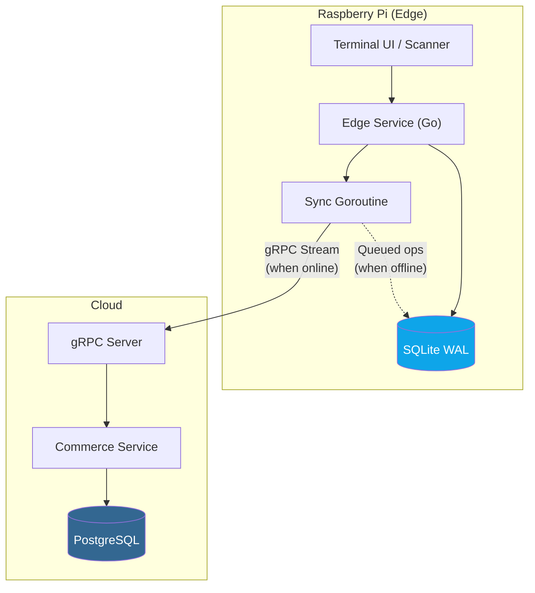
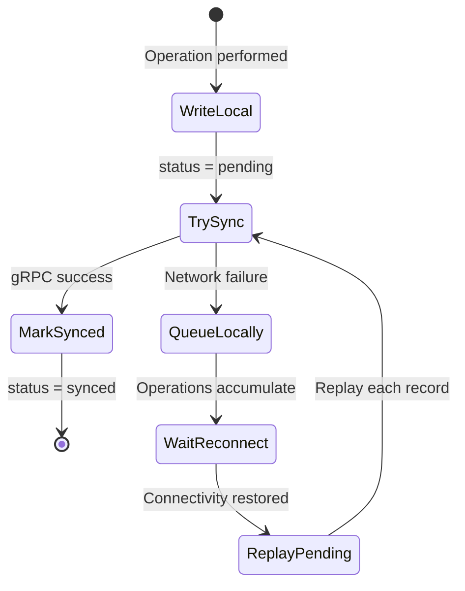
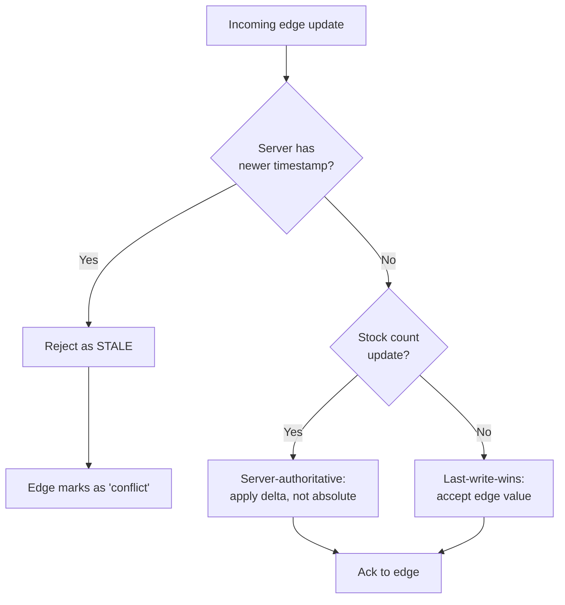

# ADR-005: Offline-First Design for Raspberry Pi Edge Node

| Field      | Value                      |
|------------|----------------------------|
| **Status** | Accepted                   |
| **Date**   | 2026-09-28                 |
| **Scope**  | Warehouse Edge Service     |

## Context

The warehouse edge service runs on a **Raspberry Pi** deployed in a physical warehouse environment. This device:

- May lose internet connectivity at any time (Wi-Fi instability, ISP outages, power cycling).
- Must continue to operate during disconnection — warehouse staff scan barcodes, pick orders, and update stock regardless of network state.
- Must eventually synchronize all local changes with the cloud Commerce service once connectivity is restored.

We need a strategy that guarantees **no data loss** during offline periods and provides **transparent reconnection** semantics.

## Decision

Implement an **offline-first architecture** with:

1. **Local SQLite database** as a write-ahead log (WAL) for all operations.
2. **gRPC streaming** for real-time bidirectional sync when online.
3. **Queue-and-replay** mechanism for automatic reconciliation on reconnect.

## Implementation

### Architecture Overview



### Step-by-Step Flow



| Step | Action | Detail |
|------|--------|--------|
| **1** | Write to local SQLite | Every operation (stock update, order fulfillment) is written with `status='pending'` and a monotonic timestamp. |
| **2** | Background sync goroutine | A persistent goroutine attempts to push pending records to the cloud via a gRPC bidirectional stream. |
| **3** | On success | The local record is marked `status='synced'` and the server acknowledges the update. |
| **4** | On network failure | The goroutine backs off (exponential backoff with jitter). Operations continue to accumulate locally. |
| **5** | On reconnect | The reconciler queries all `status='pending'` records ordered by timestamp and replays them sequentially over the gRPC stream. |
| **6** | Server validation | The cloud service validates each operation. Stale updates (based on logical clock comparison) are rejected with a `STALE` response; the edge service marks them `status='conflict'` for manual review. |

### SQLite Schema

```sql
CREATE TABLE sync_log (
    id          INTEGER PRIMARY KEY AUTOINCREMENT,
    operation   TEXT    NOT NULL,  -- 'stock_update', 'order_fulfill', 'heartbeat'
    payload     TEXT    NOT NULL,  -- JSON-encoded operation data
    status      TEXT    NOT NULL DEFAULT 'pending',  -- 'pending', 'synced', 'conflict', 'failed'
    timestamp   TEXT    NOT NULL,  -- RFC 3339 timestamp (logical clock)
    retry_count INTEGER NOT NULL DEFAULT 0,
    created_at  TEXT    NOT NULL DEFAULT (strftime('%Y-%m-%dT%H:%M:%fZ', 'now')),
    synced_at   TEXT             -- NULL until synced
);

CREATE INDEX idx_sync_log_status ON sync_log(status);
CREATE INDEX idx_sync_log_timestamp ON sync_log(timestamp);
```

### Conflict Resolution Strategy



| Conflict type        | Resolution policy                                                                 |
|----------------------|-----------------------------------------------------------------------------------|
| **Stock counts**     | **Server-authoritative** — edge sends deltas (`-3 units`), not absolute values (`47 units`). Server applies delta to its current count. |
| **Order status**     | **Last-write-wins** with timestamp comparison. If the server already has a more recent status, the edge update is rejected. |
| **General data**     | **Last-write-wins** using logical clocks. Ties broken by server preference.        |

### Why SQLite?

| Requirement                     | SQLite fit                                                    |
|---------------------------------|---------------------------------------------------------------|
| No server process               | Embedded — just a file on disk. No daemon to manage.          |
| Low resource usage              | Minimal CPU/RAM footprint, ideal for Raspberry Pi.            |
| Crash resilience                | WAL mode provides crash recovery without corruption.          |
| Single-writer concurrency       | Edge service is the only writer — no contention issues.       |
| Portable                        | Database is a single file; easy to back up or replace the SD card. |

### gRPC Service Definition (relevant RPCs)

```protobuf
service WarehouseSync {
  // Bidirectional stream for real-time sync
  rpc SyncStock(stream StockUpdate) returns (stream SyncResponse);

  // Pull pending orders for warehouse fulfillment
  rpc GetPendingOrders(WarehouseRequest) returns (PendingOrdersList);

  // Mark an order as fulfilled from the warehouse
  rpc FulfillOrder(FulfillRequest) returns (FulfillResponse);

  // Edge → Cloud heartbeat (connectivity & health monitoring)
  rpc Heartbeat(HealthStatus) returns (Ack);
}
```

## Consequences

### Positive

- **Zero downtime** — warehouse operations are never blocked by network issues.
- **No data loss** — every operation is persisted locally before any network attempt.
- **Simple deployment** — SQLite requires no additional infrastructure on the Pi.
- **Auditable** — the `sync_log` table serves as a complete audit trail of all edge operations.

### Negative

- **Brief inconsistency windows** — between the edge writing locally and the cloud receiving the sync, the two views of stock/orders diverge.
- **Conflict handling complexity** — stale updates and concurrent modifications require careful resolution logic.
- **SD card wear** — frequent SQLite writes on a Raspberry Pi's SD card can cause wear. Mitigated by using WAL mode (fewer fsyncs) and periodic log compaction.

### Mitigations

- Inconsistency windows are acceptable for a warehouse terminal — operators see local state immediately, and cloud state converges within seconds of reconnection.
- Conflict records (`status='conflict'`) are surfaced in an admin dashboard for manual review.
- Use a high-endurance SD card (industrial grade) and implement log rotation (purge `synced` records older than 30 days).
