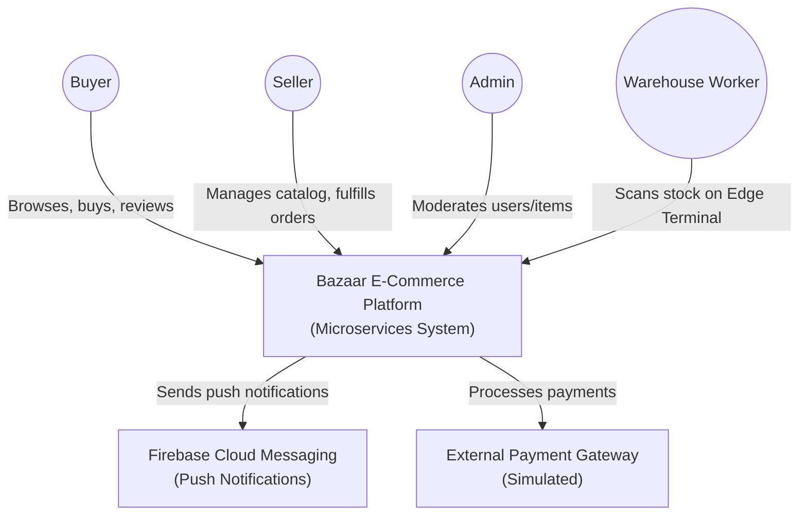
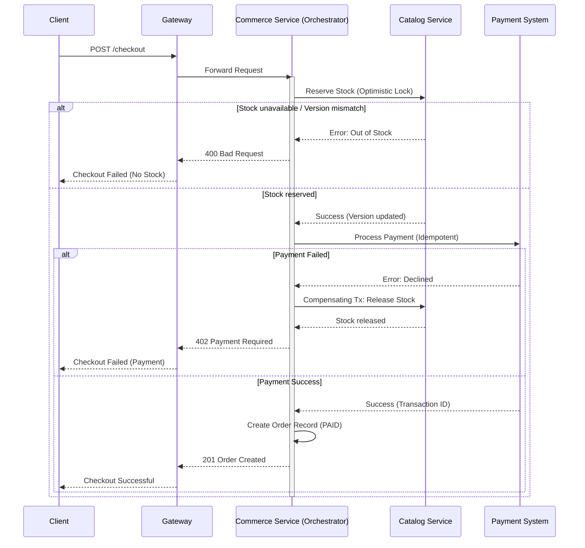
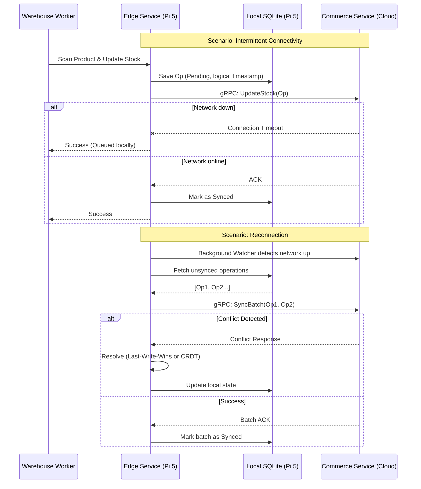
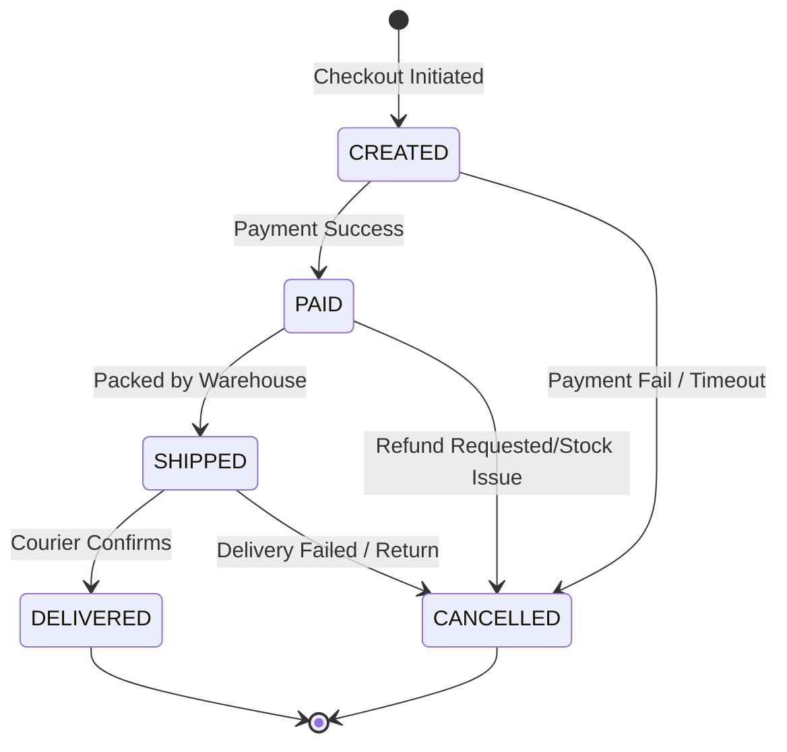

# Bazaar - System Architecture

## Overview

**Bazaar** is a microservices-based e-commerce marketplace platform, inspired by systems like Mercado Libre. Built as an advanced solo project, it demonstrates distributed systems design, polyglot programming, and edge computing via a physical warehouse node powered by a Raspberry Pi 5.

### Context & Goals
- **Developer:** Solo developer (Javier)
- **Goal:** Showcase backend and distributed systems engineering (gRPC, sagas, edge-computing, event-driven architecture) for a standout GitHub portfolio.
- **Tech Stack Highlights:** Go, Python (FastAPI), PostgreSQL, MongoDB, gRPC, NATS/Redis, Docker.

---

## 1. System Architecture (C4 Diagrams)

### 1.1 Context Diagram
The following C4 Context diagram illustrates the system boundaries and external integrations.



### 1.2 Container Diagram
The Container diagram details the internal microservices, databases, and communication paths.

```mermaid
flowchart TD
    Mobile["Mobile App\n(React Native)"]
    AdminApp["Admin Backoffice\n(React/Vite)"]
    TUI["Warehouse Terminal\n(Go CLI/TUI)"]

    Gateway["API Gateway\n(Go/Chi)"]
    Users["Users Service\n(Python/FastAPI)"]
    Catalog["Catalog Service\n(Go)"]
    Commerce["Commerce Service\n(Go)"]
    Notif["Notifications Service\n(Go)"]
    Edge["Warehouse Edge Service\n(Go on Pi 5)"]

    UsersDB[(PostgreSQL)]
    CatalogDB[(MongoDB)]
    CommerceDB[(PostgreSQL)]
    NotifDB[(PostgreSQL)]
    EdgeDB[(SQLite)]
    Broker{"Event Bus\n(NATS JetStream)"}

    Mobile -->|REST / HTTPS| Gateway
    AdminApp -->|REST / HTTPS| Gateway

    Gateway -->|REST| Users
    Gateway -->|REST| Catalog
    Gateway -->|REST| Commerce

    Users --> UsersDB
    Catalog --> CatalogDB
    Commerce --> CommerceDB
    Notif --> NotifDB

    Commerce -->|Publishes Events| Broker
    Catalog -->|Publishes Events| Broker
    Broker -->|Subscribes| Notif

    TUI -->|Local IPC / REST| Edge
    Edge --> EdgeDB
    Edge <-->|gRPC (Sync)| Commerce
```

---

## 2. Microservices Details

All services are fully containerized using Docker and are orchestrated locally via Docker Compose.

1. **Gateway** (Go - Chi/stdlib)
   - **Role:** Single entry point for external clients.
   - **Responsibilities:** JWT validation middleware, IP/User rate limiting (token bucket), request routing, correlation ID injection for distributed tracing.
   - **Health:** Exposes `/livez` and `/readyz` endpoints.

2. **Users Service** (Python - FastAPI)
   - **Role:** Authentication and Identity provider.
   - **Responsibilities:** Registration, Login (JWT issuance & refresh), OAuth integration, profile management (Buyer/Seller), and Admin operations.
   - **Storage:** PostgreSQL.

3. **Catalog Service** (Go)
   - **Role:** Inventory and product search.
   - **Responsibilities:** Product CRUD, tag/category management, advanced text and filter search, ratings, and seller reputation based on successful deliveries.
   - **Storage:** MongoDB (Flexible schema for dynamic product attributes).

4. **Commerce Service** (Go)
   - **Role:** Core transactional engine.
   - **Responsibilities:** Cart management, order lifecycle, stock safety (optimistic locking), payment orchestration, and refunds.
   - **Storage:** PostgreSQL (ACID compliance required).

5. **Notifications Service** (Go)
   - **Role:** Asynchronous communications.
   - **Responsibilities:** Listens to event bus for state changes (e.g., `order.created`, `stock.low`) and dispatches push notifications via Firebase.
   - **Storage:** PostgreSQL (Notification audit log).

6. **Warehouse Edge Service** (Go on Raspberry Pi 5)
   - **Role:** Edge computing node simulating physical warehouse terminal.
   - **Responsibilities:** Local barcode scanning (mocked or OpenCV), offline-first stock tracking. Connects back to the main backend (`Commerce Service`) via gRPC.
   - **Storage:** SQLite (Local fallback).

---

## 3. Core Workflows

### 3.1 Checkout Saga (Distributed Transaction)
The checkout process utilizes an orchestrator-based Saga pattern inside the Commerce Service to ensure eventual consistency.



### 3.2 Warehouse Edge Offline-First Sync
The edge node is designed to handle network partitions gracefully, queuing updates locally on the Pi and syncing once connectivity is restored.



### 3.3 Order Lifecycle
Orders transition through a strict state machine managed by the Commerce service.



---

## 4. Infrastructure & Communication

- **Internal Communication:**
  - **Sync:** HTTP/REST (Gateway -> Services, Service <-> Service for queries).
  - **Async:** NATS JetStream (or Redis Streams) for event broadcast (`order.created`, `stock.low`).
  - **Edge Sync:** gRPC between the Edge service (Pi) and the central Commerce service (using shared `.proto` definitions).
- **Deployment:**
  - Local dev handled via `docker-compose.yml`.
  - Edge deployment handled via `docker-compose.edge.yml` on the Raspberry Pi.
- **CI/CD:** GitHub actions for linting, testing, Docker builds, and coverage reporting.
- **Observability:** Prometheus & Grafana self-hosted (or running locally), consuming structured JSON logs with correlation IDs for cross-service tracing.
- **Load Testing:** `k6` scripts simulate peak traffic on the checkout Saga orchestration.
