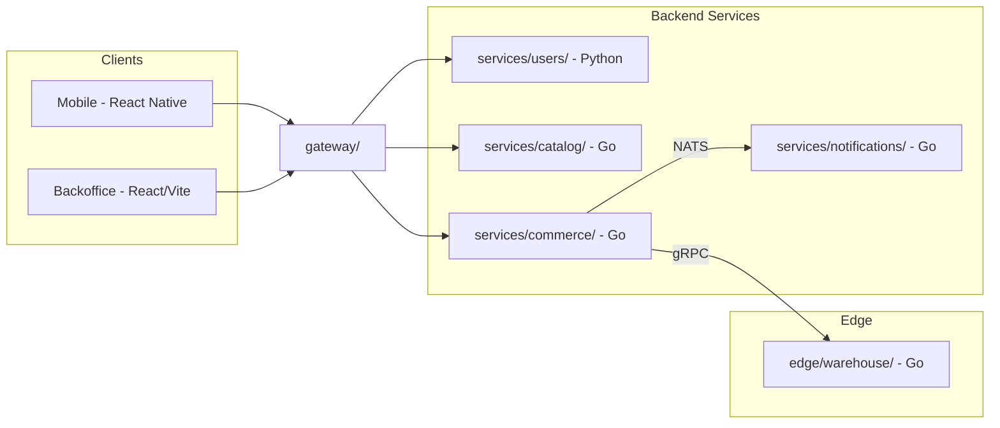
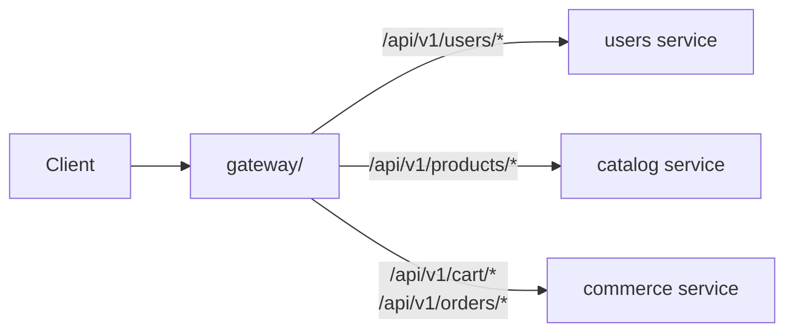
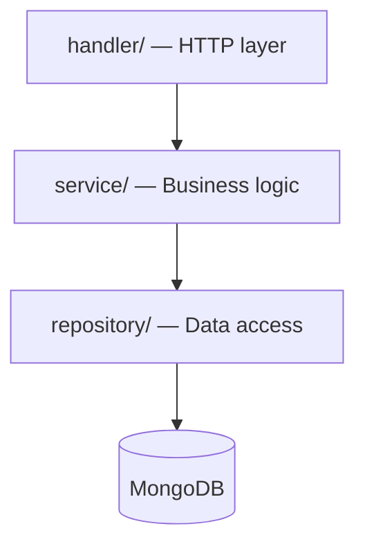
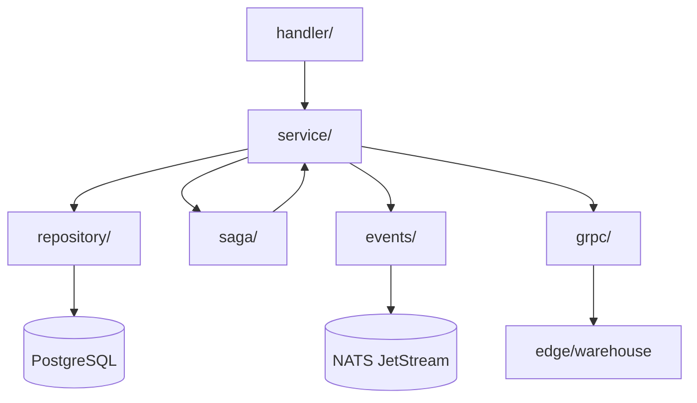
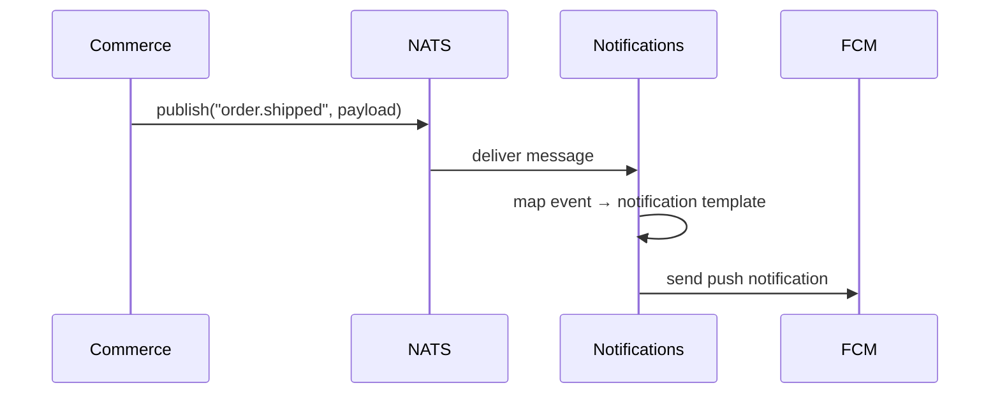
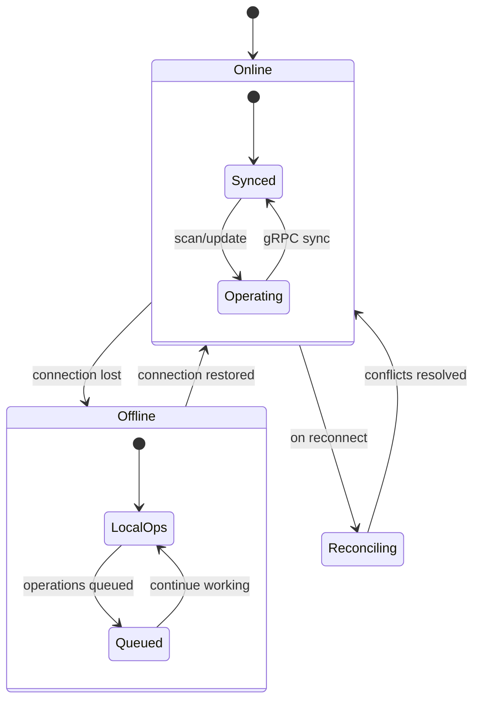

# Bazaar — Project Structure

> A polyglot microservices marketplace platform built with Go and Python.

This document describes every directory in the monorepo, explains the design decisions behind the layout, and shows how the pieces connect at build-time and run-time.

---

## High-Level Overview



---

## Full Directory Tree

```
bazaar/
├── .github/
│   └── workflows/
│       ├── ci.yml                    # Main CI: lint + test + coverage for all services
│       ├── cd.yml                    # CD: build Docker images, push to registry
│       └── edge-build.yml           # Cross-compile edge service for ARM64 (Pi)
├── gateway/                          # Go — API Gateway
│   ├── cmd/
│   │   └── gateway/
│   │       └── main.go
│   ├── internal/
│   │   ├── middleware/
│   │   │   ├── auth.go              # JWT validation
│   │   │   ├── ratelimit.go         # Token bucket rate limiter
│   │   │   ├── cors.go
│   │   │   └── correlationid.go     # Inject X-Correlation-ID
│   │   ├── proxy/
│   │   │   └── router.go           # Route to downstream services
│   │   └── health/
│   │       └── health.go           # /livez and /readyz
│   ├── config/
│   │   └── config.go               # Env-based configuration
│   ├── Dockerfile
│   ├── go.mod
│   └── go.sum
├── services/
│   ├── users/                        # Python — FastAPI
│   │   ├── main.py                   # FastAPI app factory, CORS, router mounting
│   │   ├── utils.py                  # API setup and helper functions
│   │   ├── controllers/              # Endpoint handlers & business logic
│   │   │   ├── auth_controller.py    # Register, login, token issuance
│   │   │   ├── user_controller.py    # Profile CRUD, admin actions
│   │   │   ├── token_verifier.py     # JWT verification / auth dependency
│   │   │   └── utils.py              # get_db session dependency
│   │   ├── database/                 # Database engine & session
│   │   │   ├── data.py               # Engine, SessionLocal, Base.metadata.create_all
│   │   │   └── create_db.sql         # Optional direct SQL schema script
│   │   ├── models/                   # SQLAlchemy models & Pydantic schemas
│   │   │   ├── base.py               # DeclarativeBase, shared schemas
│   │   │   ├── user.py               # User table model + Pydantic schemas
│   │   │   └── constants.py          # User roles (buyer, seller, admin)
│   │   ├── router/                   # API routing
│   │   │   └── router.py             # APIRouter connecting endpoints to controllers
│   │   ├── tests/
│   │   │   ├── conftest.py
│   │   │   ├── test_auth.py
│   │   │   └── test_users.py
│   │   ├── Dockerfile
│   │   ├── requirements.txt
│   │   ├── requirements-dev.txt
│   │   └── pyproject.toml
│   ├── catalog/                      # Go
│   │   ├── cmd/
│   │   │   └── catalog/
│   │   │       └── main.go
│   │   ├── internal/
│   │   │   ├── domain/             # Domain models
│   │   │   │   ├── product.go
│   │   │   │   ├── category.go
│   │   │   │   ├── review.go
│   │   │   │   └── wishlist.go
│   │   │   ├── handler/            # HTTP handlers
│   │   │   │   ├── product.go
│   │   │   │   ├── search.go
│   │   │   │   ├── review.go
│   │   │   │   └── wishlist.go
│   │   │   ├── repository/         # MongoDB repositories
│   │   │   │   ├── product_repo.go
│   │   │   │   └── review_repo.go
│   │   │   └── service/            # Business logic
│   │   │       ├── product_svc.go
│   │   │       ├── search_svc.go
│   │   │       └── reputation_svc.go  # Seller reputation calc
│   │   ├── config/
│   │   │   └── config.go
│   │   ├── Dockerfile
│   │   ├── go.mod
│   │   └── go.sum
│   ├── commerce/                     # Go — THE CORE SERVICE
│   │   ├── cmd/
│   │   │   └── commerce/
│   │   │       └── main.go
│   │   ├── internal/
│   │   │   ├── domain/
│   │   │   │   ├── cart.go
│   │   │   │   ├── order.go        # Order state machine
│   │   │   │   ├── payment.go
│   │   │   │   ├── coupon.go
│   │   │   │   └── stock.go
│   │   │   ├── handler/
│   │   │   │   ├── cart.go
│   │   │   │   ├── checkout.go
│   │   │   │   ├── order.go
│   │   │   │   └── coupon.go
│   │   │   ├── repository/
│   │   │   │   ├── order_repo.go
│   │   │   │   ├── stock_repo.go   # SELECT FOR UPDATE, optimistic lock
│   │   │   │   └── payment_repo.go
│   │   │   ├── service/
│   │   │   │   ├── cart_svc.go
│   │   │   │   ├── checkout_svc.go # SAGA ORCHESTRATOR
│   │   │   │   ├── order_svc.go
│   │   │   │   ├── payment_svc.go  # Idempotent payment simulation
│   │   │   │   └── stock_svc.go    # Race condition handling
│   │   │   ├── saga/
│   │   │   │   ├── checkout_saga.go  # Step definitions + compensations
│   │   │   │   └── saga_runner.go    # Generic saga executor
│   │   │   ├── events/
│   │   │   │   └── publisher.go    # NATS event publishing
│   │   │   └── grpc/
│   │   │       └── warehouse.go    # gRPC server for edge sync
│   │   ├── config/
│   │   │   └── config.go
│   │   ├── db/
│   │   │   └── migrations/         # golang-migrate SQL files
│   │   │       ├── 000001_create_orders.up.sql
│   │   │       ├── 000001_create_orders.down.sql
│   │   │       ├── 000002_create_stock.up.sql
│   │   │       └── ...
│   │   ├── Dockerfile
│   │   ├── go.mod
│   │   └── go.sum
│   └── notifications/               # Go
│       ├── cmd/
│       │   └── notifications/
│       │       └── main.go
│       ├── internal/
│       │   ├── consumer/
│       │   │   └── nats.go         # NATS JetStream consumer
│       │   ├── handler/
│       │   │   └── notification.go
│       │   └── provider/
│       │       └── firebase.go     # FCM push sender
│       ├── Dockerfile
│       ├── go.mod
│       └── go.sum
├── edge/
│   └── warehouse/                    # Go — Raspberry Pi service
│       ├── cmd/
│       │   └── warehouse/
│       │       └── main.go
│       ├── internal/
│       │   ├── sync/
│       │   │   ├── client.go       # gRPC client to commerce service
│       │   │   ├── queue.go        # Offline operation queue
│       │   │   └── reconciler.go   # Conflict resolution on reconnect
│       │   ├── storage/
│       │   │   └── sqlite.go       # Local SQLite persistence
│       │   ├── scanner/
│       │   │   └── barcode.go      # Mock barcode input (or Pi Camera)
│       │   └── tui/
│       │       └── app.go          # Terminal UI (bubbletea)
│       ├── Dockerfile               # Multi-arch (ARM64)
│       ├── go.mod
│       └── go.sum
├── proto/                            # Shared protobuf definitions
│   ├── warehouse/
│   │   └── v1/
│   │       └── warehouse.proto     # Stock sync, order fulfillment RPCs
│   ├── buf.gen.yaml
│   └── buf.yaml
├── clients/
│   ├── mobile/                       # React Native (AI-generated)
│   │   ├── src/
│   │   ├── package.json
│   │   └── ...
│   └── backoffice/                   # React + Vite (AI-generated)
│       ├── src/
│       ├── package.json
│       └── ...
├── infra/
│   ├── docker-compose.yml           # Full local dev stack
│   ├── docker-compose.edge.yml      # Pi deployment
│   ├── k6/
│   │   ├── checkout_stress.js       # Load test: concurrent checkouts
│   │   ├── catalog_search.js        # Load test: search under load
│   │   └── README.md
│   ├── grafana/
│   │   └── dashboards/
│   │       ├── orders.json
│   │       └── system.json
│   └── prometheus/
│       └── prometheus.yml
├── docs/
│   ├── architecture.md
│   ├── roadmap.md
│   ├── project-structure.md
│   └── adr/
│       ├── 001-polyglot-go-python.md
│       ├── 002-saga-over-2pc.md
│       ├── 003-mongodb-for-catalog.md
│       ├── 004-nats-event-bus.md
│       └── 005-edge-offline-strategy.md
├── scripts/
│   ├── setup.sh                     # Bootstrap local dev environment
│   ├── seed.sh                      # Seed databases with test data
│   └── proto-gen.sh                 # Generate Go code from .proto
├── .gitignore
├── .editorconfig
├── Makefile                         # Top-level make targets
├── LICENSE
└── README.md                        # Hero README with badges, diagrams, demo GIFs
```

---

## Directory-by-Directory Guide

### `.github/workflows/`

CI/CD pipelines running on GitHub Actions.

| File | Purpose |
|---|---|
| `ci.yml` | Triggered on every PR. Runs linting (`golangci-lint`, `ruff`), unit tests, and uploads coverage reports. Each service is a separate job so failures are isolated. |
| `cd.yml` | Triggered on merge to `main`. Builds Docker images for every service and pushes them to a container registry (GHCR or Docker Hub). Tags images with the short SHA. |
| `edge-build.yml` | A specialised workflow that cross-compiles the edge warehouse service for `linux/arm64` using Docker Buildx. This produces an image that runs on Raspberry Pi hardware. |

**Key decision:** Each service has its own Dockerfile and its own CI job. This avoids the "change one service, rebuild everything" anti-pattern. The `cd.yml` workflow uses a matrix strategy across service directories.

---

### `gateway/` — API Gateway (Go)

The single entry-point for all client traffic. Every HTTP request from the mobile app or backoffice SPA passes through this service before reaching any backend.



#### Internal Layout

| Package | Responsibility |
|---|---|
| `cmd/gateway/main.go` | Wires everything together: loads config, registers middleware, starts the HTTP server. |
| `internal/middleware/auth.go` | Validates JWTs on incoming requests. Extracts claims and injects the user identity into the request context. Does **not** issue tokens — that is the users service's job. |
| `internal/middleware/ratelimit.go` | Per-IP token-bucket rate limiter. Protects downstream services from bursts. Configurable via environment variables (requests per second, burst size). |
| `internal/middleware/cors.go` | Standard CORS headers for the backoffice SPA. |
| `internal/middleware/correlationid.go` | Generates (or propagates) `X-Correlation-ID` on every request. This ID is forwarded to downstream services and written into every log line, making distributed tracing straightforward even without Jaeger. |
| `internal/proxy/router.go` | Path-prefix routing. Maps incoming URL prefixes to downstream service base URLs. Uses `httputil.ReverseProxy` with custom transport for timeout and retry policies. |
| `internal/health/health.go` | Kubernetes-style health endpoints: `/livez` (is the process alive?) and `/readyz` (are downstream dependencies reachable?). |
| `config/config.go` | Reads configuration from environment variables, with sensible defaults for local development. No config files, no YAML — just `os.Getenv` wrapped in a typed struct. |

**Why a custom gateway instead of Kong/Traefik?** Learning opportunity. Writing the reverse proxy, JWT validation, and rate limiter from scratch forces engagement with HTTP internals, context propagation, and middleware chaining patterns.

---

### `services/users/` — Users & Auth (Python / FastAPI)

The only Python service in the stack. Handles everything identity-related: registration, login, JWT issuance, profile management, and admin operations.

#### Internal Layout

```
app/
├── main.py              # App factory: creates FastAPI instance, includes routers
├── config.py            # pydantic-settings: typed, validated config from env vars
├── models/              # SQLAlchemy ORM models (DB schema)
│   ├── user.py
│   └── profile.py
├── schemas/             # Pydantic models (API contract)
│   ├── user.py
│   └── auth.py
├── api/
│   ├── v1/
│   │   ├── auth.py      # POST /login, POST /register, POST /refresh
│   │   ├── users.py     # GET/PATCH /me, GET /users/:id
│   │   └── admin.py     # Admin-only: list users, ban, role changes
│   └── deps.py          # FastAPI Depends() factories
├── core/
│   ├── security.py      # Password hashing (bcrypt), JWT encode/decode
│   └── exceptions.py    # Custom exception classes + handlers
└── db/
    ├── session.py        # Async SQLAlchemy engine + session maker
    └── migrations/       # Alembic migration scripts
```

**models/ vs schemas/ — why both?** This is a deliberate separation:

- **`models/`** = SQLAlchemy ORM classes. They map to database tables. They know about columns, relationships, and indexes. They are never exposed directly over the API.
- **`schemas/`** = Pydantic models. They define the JSON shape of API requests and responses. They handle validation, serialisation, and documentation (OpenAPI).

This separation means the database schema and the API contract can evolve independently. A column rename in the database doesn't force a breaking API change.

**`api/deps.py`** is where FastAPI's dependency injection really shines. It defines reusable dependencies like:

- `get_db()` — yields an async database session and ensures cleanup.
- `get_current_user()` — reads the JWT from the `Authorization` header, validates it, and returns the user object.
- `require_admin()` — wraps `get_current_user()` and raises 403 if the user doesn't have the admin role.

**Why Python for this service?** See [ADR-001](adr/001-polyglot-go-python.md). In short: the Python ecosystem for authentication is mature (`passlib`, `python-jose`, `authlib`), and FastAPI's automatic OpenAPI generation makes the auth endpoints self-documenting.

---

### `services/catalog/` — Product Catalog (Go)

Read-heavy service for browsing, searching, and reviewing products. Backed by MongoDB.

#### Layered Architecture



| Layer | Package | Rules |
|---|---|---|
| **Handler** | `internal/handler/` | Parses HTTP requests, calls service methods, serialises responses. Knows about `http.Request` and `http.ResponseWriter`. Does **not** contain business logic. |
| **Service** | `internal/service/` | Pure business logic. Operates on domain types. Has no knowledge of HTTP or database drivers. Receives repository interfaces via constructor injection. |
| **Repository** | `internal/repository/` | Translates domain operations into database queries. Knows about MongoDB driver APIs. Returns domain types, not BSON documents. |
| **Domain** | `internal/domain/` | Plain Go structs and enums. No external dependencies. Shared across all layers. |

**Why this layering?** It's the standard clean-architecture approach adapted for Go:

1. **Testability** — Services can be tested with mock repositories. Handlers can be tested with mock services. No database needed for unit tests.
2. **Replaceability** — Swapping MongoDB for PostgreSQL means rewriting the repository layer only. The service and handler layers don't change.
3. **Readability** — When debugging a bug in search ranking, you know to look in `search_svc.go`, not in an HTTP handler.

#### Key Files

| File | Detail |
|---|---|
| `domain/product.go` | `Product` struct: ID, title, description, price, seller ID, category, images, timestamps. |
| `domain/review.go` | `Review` struct: rating (1-5), comment, buyer ID, product ID. |
| `domain/wishlist.go` | Per-user wishlist of product IDs. |
| `service/reputation_svc.go` | Calculates seller reputation from aggregate review scores. Uses a weighted formula that accounts for review recency and volume. |
| `service/search_svc.go` | Wraps MongoDB text search. Supports filters (category, price range, rating). Could be upgraded to Elasticsearch later without touching the handler layer. |
| `repository/product_repo.go` | Implements `ProductRepository` interface. All MongoDB queries live here. Uses the official `go.mongodb.org/mongo-driver`. |

**Why MongoDB for the catalog?** See [ADR-003](adr/003-mongodb-for-catalog.md). Products have flexible schemas (different attribute sets per category), deeply nested data (image galleries, variant options), and the access pattern is overwhelmingly read-heavy — all of which play to MongoDB's strengths.

---

### `services/commerce/` — Commerce Engine (Go) ★ Core Service

This is the most complex service in the system. It owns the cart, checkout, orders, payments, stock, and coupons. It is the **saga orchestrator** for the checkout flow.

#### Layered Architecture

Same handler → service → repository pattern as the catalog service, with two additional packages:



#### Package Breakdown

| Package | Responsibility |
|---|---|
| `domain/` | Domain models — `Cart`, `Order`, `Payment`, `Coupon`, `Stock`. `order.go` contains the **order state machine** (pending → confirmed → paid → shipped → delivered / cancelled). State transitions are methods on the `Order` struct with validation. |
| `handler/` | HTTP handlers for cart operations, checkout initiation, order queries, and coupon management. |
| `service/cart_svc.go` | Add/remove items, apply coupons, calculate totals. Cart state is stored in Redis (or PostgreSQL, depending on configuration). |
| `service/checkout_svc.go` | **Saga orchestrator.** When a user checks out, this service kicks off a multi-step saga: validate stock → reserve stock → process payment → create order → emit events. If any step fails, it runs compensating actions in reverse. |
| `service/payment_svc.go` | Simulates payment processing. Every payment call is **idempotent** — duplicate calls with the same idempotency key return the same result. This is critical for saga retries. |
| `service/stock_svc.go` | Stock management with **race condition handling**. Uses `SELECT ... FOR UPDATE` for pessimistic locking when reserving stock, and optimistic locking (version column) for general updates. |
| `saga/checkout_saga.go` | Defines the checkout saga steps and their compensations. Each step is a function with a corresponding undo function. |
| `saga/saga_runner.go` | A **generic saga executor**: takes a list of steps, runs them in order, and runs compensations in reverse on failure. Logs every step transition for debugging. Reusable for future sagas (e.g., returns, refunds). |
| `events/publisher.go` | Publishes domain events (`order.created`, `order.shipped`, `payment.completed`) to NATS JetStream. These events are consumed by the notifications service and potentially by the catalog service (to update "sold count"). |
| `grpc/warehouse.go` | Exposes a gRPC server that the edge warehouse service connects to for stock synchronisation. Defined by the protobuf in `proto/warehouse/v1/`. |

#### Database Migrations

```
db/migrations/
├── 000001_create_orders.up.sql
├── 000001_create_orders.down.sql
├── 000002_create_stock.up.sql
└── ...
```

Uses [`golang-migrate`](https://github.com/golang-migrate/migrate). Every migration has an `up` (apply) and `down` (rollback) file. Migrations run automatically on service startup in development and are applied manually (via CI) in production.

**Why PostgreSQL for commerce?** Financial data and order state machines demand ACID transactions, foreign keys, and strong consistency. This is not negotiable — eventual consistency is fine for product catalogs but not for payments and stock reservation.

---

### `services/notifications/` — Push Notifications (Go)

An event-driven service with no HTTP API. It listens to NATS JetStream for domain events and sends push notifications to users via Firebase Cloud Messaging (FCM).



| Package | Responsibility |
|---|---|
| `consumer/nats.go` | Subscribes to NATS JetStream subjects. Uses durable consumers for at-least-once delivery. Acknowledges messages only after successful FCM send. |
| `handler/notification.go` | Maps domain events to notification payloads (title, body, deep link). |
| `provider/firebase.go` | Wraps the Firebase Admin SDK. Handles FCM token management and send retries. |

**Why a separate service?** Decoupling. The commerce service doesn't need to know about push notifications, email, SMS, or any future notification channel. It just emits events. The notifications service can be extended independently (add email, add Slack webhooks) without touching commerce code.

---

### `edge/warehouse/` — Warehouse Terminal (Go, Raspberry Pi)

A terminal application that runs on a Raspberry Pi in a physical warehouse. It allows warehouse workers to scan barcodes, manage stock, and fulfil orders — **even when the internet connection drops**.



| Package | Responsibility |
|---|---|
| `sync/client.go` | gRPC client that connects to the commerce service's gRPC server. Streams stock updates bidirectionally. |
| `sync/queue.go` | Offline operation queue. When the network is unavailable, operations (stock adjustments, order fulfillments) are queued in SQLite and replayed when connectivity returns. |
| `sync/reconciler.go` | Conflict resolution engine. When the edge reconnects, it compares local state with the server. Uses last-write-wins with manual conflict escalation for critical discrepancies (e.g., stock went negative on the server while offline). |
| `storage/sqlite.go` | Local SQLite database. Stores a subset of product/stock data for offline access, plus the operation queue. |
| `scanner/barcode.go` | Barcode input interface. Can read from a USB barcode scanner (which acts as a keyboard) or from a Pi Camera module via a mock interface for development. |
| `tui/app.go` | Terminal UI built with [Bubble Tea](https://github.com/charmbracelet/bubbletea). Displays stock levels, order queue, and scan results. Designed for small screens and keyboard-only operation. |

**Why Go for the edge?** Go compiles to a single static binary. No runtime dependencies, no virtualenv, no node_modules. Copy the binary to the Pi, run it. This is critical for edge deployments where you can't assume anything about the host environment.

---

### `proto/` — Protocol Buffers

Shared protobuf definitions for gRPC communication between the commerce service and the edge warehouse.

```
proto/
├── warehouse/
│   └── v1/
│       └── warehouse.proto     # StockSync, OrderFulfillment RPCs
├── buf.gen.yaml                # Code generation config (Go plugins)
└── buf.yaml                    # Buf module config, linting rules
```

The proto directory is **not** part of any Go module. It's a standalone Buf module. Running `scripts/proto-gen.sh` (or `buf generate`) produces Go code that is placed into the consuming services (`commerce/` and `edge/warehouse/`).

**Versioning:** The `v1/` subdirectory allows introducing `v2/` in the future without breaking existing clients.

---

### `clients/`

Frontend applications. Both are AI-generated (scaffolded with Cursor/Copilot) and are not the primary focus of the project.

| Directory | Stack | Purpose |
|---|---|---|
| `mobile/` | React Native | Consumer-facing mobile app. Browse products, manage cart, track orders. |
| `backoffice/` | React + Vite | Admin dashboard. Manage users, view orders, monitor system health. |

Both clients communicate exclusively through the API gateway — they never call backend services directly.

---

### `infra/` — Infrastructure & Observability

```
infra/
├── docker-compose.yml          # Full local dev stack
├── docker-compose.edge.yml     # Pi deployment
├── k6/                         # Load tests
├── grafana/                    # Dashboard definitions
└── prometheus/                 # Metrics scraping config
```

#### `docker-compose.yml`

Spins up the entire platform locally with a single command:

```bash
docker compose -f infra/docker-compose.yml up
```

This includes:
- All 5 backend services (gateway, users, catalog, commerce, notifications)
- PostgreSQL (for users + commerce)
- MongoDB (for catalog)
- Redis (for sessions/caching)
- NATS (for event streaming)
- Prometheus + Grafana (for observability)

#### `docker-compose.edge.yml`

A minimal compose file for running the warehouse service on a Raspberry Pi alongside a local SQLite volume mount.

#### `k6/`

Load test scripts written in JavaScript for [k6](https://k6.io/):

| Script | Tests |
|---|---|
| `checkout_stress.js` | Simulates 50+ concurrent users attempting checkout simultaneously. Validates that stock locking prevents overselling and that the saga handles contention gracefully. |
| `catalog_search.js` | Hammers the search endpoint with varied queries to test MongoDB text search performance under load. |

#### `grafana/dashboards/`

Pre-built Grafana dashboards (exported as JSON):

- **`orders.json`** — Order throughput, checkout latency p50/p95/p99, saga failure rate, payment success rate.
- **`system.json`** — Per-service CPU/memory, request rates, error rates, NATS queue depths.

#### `prometheus/prometheus.yml`

Scrape configuration targeting all services' `/metrics` endpoints. Each Go service exposes Prometheus metrics via `promhttp`. The Python users service uses `prometheus-fastapi-instrumentator`.

---

### `docs/`

Project documentation, including this file.

| File | Content |
|---|---|
| `architecture.md` | High-level architecture overview, communication patterns, data flow diagrams. |
| `roadmap.md` | Feature roadmap and milestone tracking. |
| `project-structure.md` | This file. |

#### `docs/adr/` — Architecture Decision Records

Lightweight records of significant architectural decisions, following the [Michael Nygard ADR format](https://cognitect.com/blog/2011/11/15/documenting-architecture-decisions):

| ADR | Decision |
|---|---|
| [001](adr/001-polyglot-go-python.md) | Use Go for core services and Python for the users service. |
| [002](adr/002-saga-over-2pc.md) | Use the saga pattern instead of two-phase commit for distributed transactions. |
| [003](adr/003-mongodb-for-catalog.md) | Use MongoDB for the product catalog (flexible schema, read-heavy workload). |
| [004](adr/004-nats-event-bus.md) | Use NATS JetStream as the event bus between services. |
| [005](adr/005-edge-offline-strategy.md) | Offline-first strategy for the edge warehouse service. |

---

### `scripts/`

Developer utility scripts. All are idempotent and safe to re-run.

| Script | Purpose |
|---|---|
| `setup.sh` | Installs prerequisites (Go, Python, Docker, Buf CLI), creates `.env` files with defaults, pulls Docker images. Run once after cloning. |
| `seed.sh` | Populates databases with test data: sample users, products, categories, reviews. Uses the services' APIs, not direct DB inserts, to ensure data passes validation. |
| `proto-gen.sh` | Runs `buf generate` to produce Go code from the `.proto` files. Outputs are placed into the `commerce/` and `edge/warehouse/` modules. |

---

### Root Files

| File | Purpose |
|---|---|
| `Makefile` | Top-level make targets: `make up` (docker compose), `make test` (all services), `make lint`, `make proto`, `make seed`. Each target delegates to the appropriate tool/script. |
| `README.md` | The project's public face. Includes badges (CI status, coverage), an architecture diagram, quickstart instructions, and demo GIFs. |
| `.gitignore` | Covers Go binaries, Python `__pycache__`, `node_modules`, `.env` files, IDE configs, and generated protobuf code. |
| `.editorconfig` | Enforces consistent whitespace and line endings across the team: tabs for Go, 4-space indent for Python, 2-space indent for YAML/JSON. |
| `LICENSE` | Project licence. |

---

## Cross-Cutting Patterns

### The Go Service Template

Every Go service follows the same internal structure:

```
service-name/
├── cmd/service-name/main.go    # Entrypoint, wiring
├── internal/
│   ├── domain/                 # Pure data types
│   ├── handler/                # HTTP (or gRPC) interface
│   ├── service/                # Business logic
│   └── repository/             # Data access
├── config/config.go            # Environment-based config
├── Dockerfile
├── go.mod
└── go.sum
```

This consistency has concrete benefits:

1. **Onboarding** — A new developer who understands one service immediately understands all of them.
2. **Code generation** — The pattern is regular enough that new services can be scaffolded from a template.
3. **Code review** — Reviewers know exactly where to look for business logic (service/) vs. data access (repository/) vs. HTTP handling (handler/).

### Dependency Flow

Dependencies always point inward:

```
handler → service → repository
                  → domain (shared by all layers)
```

- Handlers depend on services (never on repositories directly).
- Services depend on repository **interfaces** (not implementations).
- Domain types have zero external dependencies.

This means you can test the service layer with mock repositories, and test handlers with mock services. Database and HTTP are implementation details at the edges.

### Configuration

All services use environment variables for configuration. No YAML files, no JSON configs, no CLI flags for service configuration. This is a deliberate choice:

- Environment variables are the standard for containerised applications (12-factor app).
- Docker Compose and Kubernetes both have first-class support for env vars.
- It eliminates the "which config file do I edit?" question.

Each service wraps `os.Getenv` calls in a typed config struct (Go) or pydantic-settings model (Python) with defaults suitable for local development.

### Error Handling

- **Go services:** Explicit error returns. No panics in business logic. Errors are wrapped with context (`fmt.Errorf("reserve stock: %w", err)`) and propagated up the call stack. Handlers translate domain errors into appropriate HTTP status codes.
- **Python service:** Custom exception classes in `core/exceptions.py`. FastAPI exception handlers translate them into JSON error responses with consistent structure.

### Observability

Every service exposes:

- **Metrics** — Prometheus-compatible `/metrics` endpoint. Request count, latency histograms, error rates, and domain-specific metrics (orders per minute, saga failure rate).
- **Structured logging** — JSON log lines with correlation ID, service name, and request metadata.
- **Health checks** — `/livez` and `/readyz` for Kubernetes compatibility.
