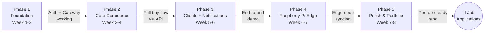
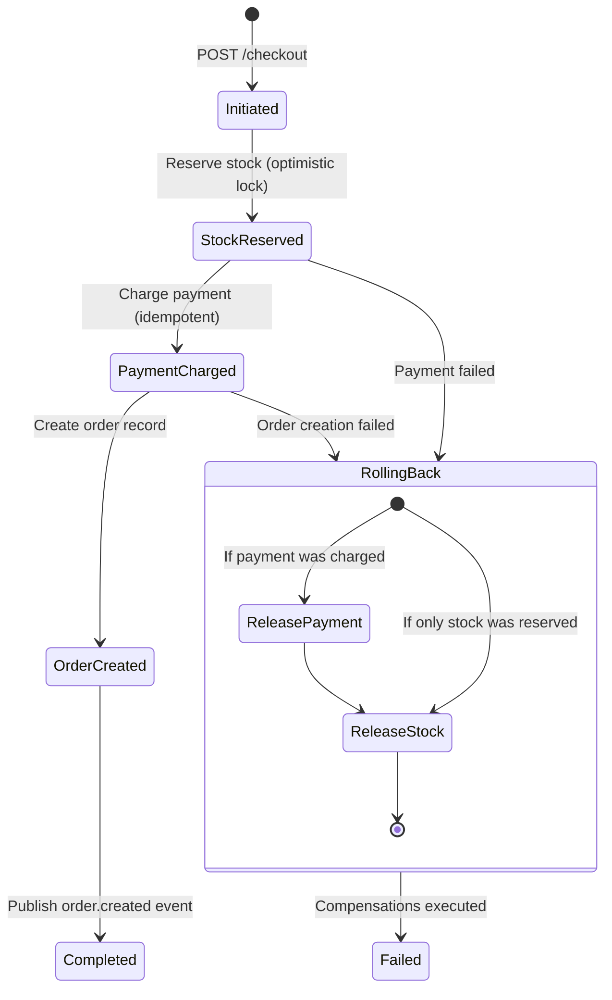
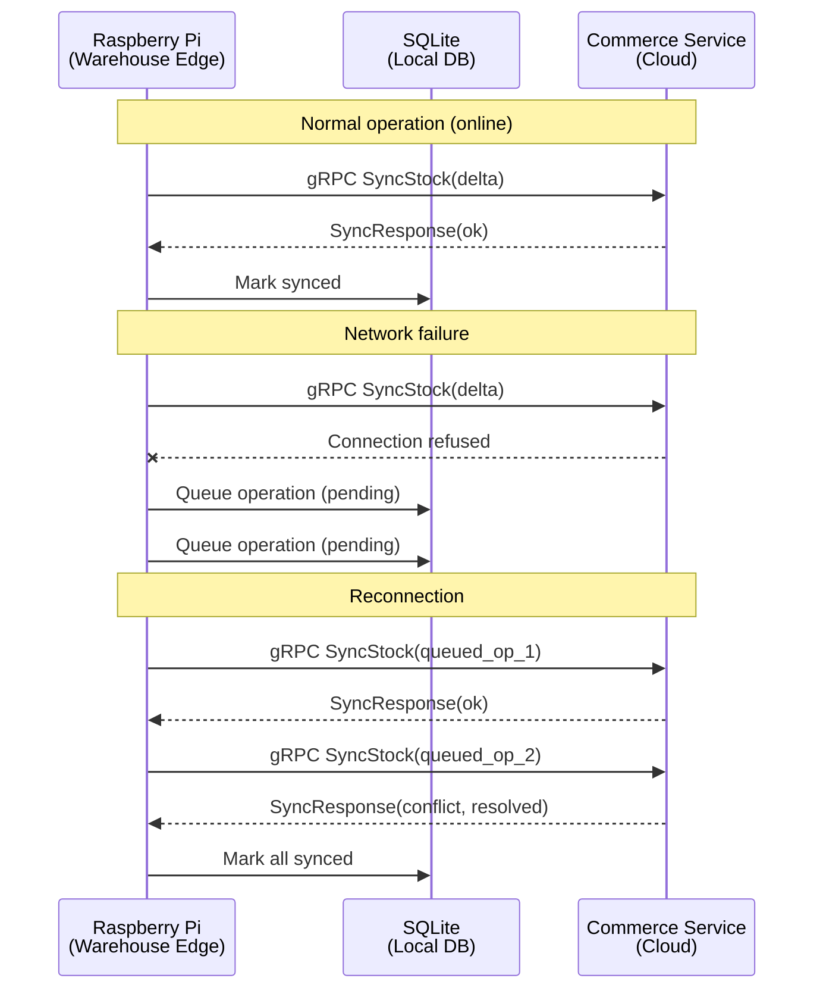

# Bazaar — Development Roadmap

> A phased plan for a solo developer to build a production-quality marketplace in 6–8 weeks.

> [!IMPORTANT]
> **Backend-first.** Every phase produces a deployable, demo-able increment. APIs are proven working (via Postman / httpie) before any frontend code is written. Frontend tasks marked `[AI]` will be largely AI-generated and are not where you invest deep engineering time.

---

## Phase 1 — Foundation (Week 1–2)

**Goal:** Working Users CRUD/Auth in Python, then routing and protecting endpoints through the API Gateway.

| # | Task | Est. Hours | Notes |
|---|------|-----------|-------|
| 1.1 | [x] **Repo scaffold** — Go workspace (`go.work`) with `gateway/`, `catalog/`, `commerce/`, `warehouse/` modules; Python setup for `users/` | 3h | Completed. |
| 1.2 | [x] **Docker Compose** — PostgreSQL 16, MongoDB 7, NATS w/ JetStream enabled, Redis, all with named volumes and health checks | 3h | Completed. |
| 1.3 | [ ] **Users service (Python/FastAPI)** — registration (`POST /api/v1/auth/register`), login (`POST /api/v1/auth/login`), JWT issuance (RS256/HS256), profile CRUD (`GET/PUT /api/v1/users/me`) | 8h | Follows familiar `ms_courses` structure (`controllers/`, `models/`, `router/`, `database/`). Stores users in PostgreSQL. |
| 1.4 | [ ] **Gateway service (Go)** — HTTP reverse proxy routing to Users service, `/livez` and `/readyz` health endpoints | 5h | Simple reverse proxy using `net/http` + `httputil.ReverseProxy` or Chi router. |
| 1.5 | [ ] **Gateway middleware** — JWT validation, token-bucket rate limiting (`golang.org/x/time/rate`), `X-Correlation-ID` injection, structured logging (`log/slog`) | 6h | Validates JWT issued by Users service; forwards `X-User-Id` downstream. |
| 1.6 | [ ] **OAuth2 skeleton** — Google OAuth login endpoint (stub that returns a JWT; real flow is stretch goal) | 2h | Just prove the redirect + callback pattern works. Don't block on getting Google credentials. |
| 1.7 | [ ] **CI pipeline & tests** — GitHub Actions: lint (`golangci-lint`, `ruff`), unit tests, docker builds | 4h | Fail fast on lint errors. Run Python tests with `pytest`. |
| 1.8 | [ ] **API collection** — Document endpoints with Postman / httpie / OpenAPI Swagger | 2h | Test registration, login, and gateway proxying. |

**Total estimate: ~33 hours**

### Key Risks

| Risk | Mitigation |
|------|------------|
| JWT signing mismatch between Python (issuer) and Go (validator) | Keep key format consistent (PEM or secret) and test token round-trip immediately after Gateway is wired. |
| Docker networking issues between services | Use a single Docker network (`bazaar-net`). Reference services by container name. |
| Scope creep on the Gateway | The gateway is a **reverse proxy + auth/rate-limit middleware**. No service discovery or circuit breaking needed yet. |

### Definition of Done

- [ ] `docker compose up` brings up infrastructure + users service + gateway
- [ ] `POST /api/v1/auth/register` → creates a user in PostgreSQL
- [ ] `POST /api/v1/auth/login` → returns a signed JWT
- [ ] `GET /api/v1/users/me` with `Authorization: Bearer <token>` → returns profile through the gateway
- [ ] Request without token on protected route → `401 Unauthorized`
- [ ] Rate limiter returns `429` after burst exceeded
- [ ] CI pipeline passes on push to `main`

---

## Phase 2 — Core Commerce (Week 3–4)

**Goal:** A complete buy flow working end-to-end via API calls — browse → add to cart → checkout → order confirmed.

| # | Task | Est. Hours | Notes |
|---|------|-----------|-------|
| 2.1 | [ ] **Catalog service (Go)** — Product CRUD (`POST/GET/PUT/DELETE /products`), category taxonomy, image URL field (Cloudinary URLs) | 6h | MongoDB storage. Validate product ownership (seller = JWT user). |
| 2.2 | [ ] **Catalog search** — MongoDB text index on name + description, filter by category/price range, pagination with cursor | 4h | Don't build Elasticsearch. MongoDB `$text` is enough for a portfolio project. |
| 2.3 | [ ] **Commerce service (Go)** — Cart management: add item, update quantity, remove item, get cart | 5h | Store carts in PostgreSQL (user_id + product snapshots). Validate stock on add. |
| 2.4 | [ ] **Stock validation** — Check available quantity against catalog service on cart operations | 2h | Synchronous HTTP call from commerce → catalog. Simple for now. |
| 2.5 | [ ] **Checkout saga — orchestrator** — Saga coordinator that drives the checkout sequence | 6h | Implement as a state machine inside the commerce service. States: `INITIATED → STOCK_RESERVED → PAYMENT_CHARGED → ORDER_CREATED → COMPLETED`. |
| 2.6 | [ ] **Checkout saga — stock reservation** — Optimistic locking on product quantity (MongoDB `findOneAndUpdate` with version check) | 4h | Reservation expires after 10 minutes (TTL). Compensate = release reservation. |
| 2.7 | [ ] **Checkout saga — payment simulation** — Idempotent charge endpoint with idempotency keys | 4h | Simulate success 90% of the time, failure 10%. Store idempotency keys in PostgreSQL to prevent double charges. |
| 2.8 | [ ] **Checkout saga — order creation** — Create order record with state machine (`PENDING → CONFIRMED → SHIPPED → DELIVERED → CANCELLED`) | 4h | Store in PostgreSQL. Include order items snapshot, totals, timestamps. |
| 2.9 | [ ] **Checkout saga — compensating transactions** — On any step failure, roll back all previous steps in reverse order | 4h | Log every compensation. Test failure at each step. This is what interviewers will ask about. |
| 2.10 | [ ] **Event bus** — NATS JetStream: publish `order.created`, `order.confirmed`, `order.cancelled` events | 4h | Define event schemas as Go structs. Use durable consumers. At-least-once delivery. |
| 2.11 | [ ] **Reviews** — `POST /products/{id}/reviews` (only for delivered orders), average rating calculation, seller reputation score | 4h | Verify the user actually bought and received the product. Store in PostgreSQL. |
| 2.12 | [ ] **Tests** — Unit tests for saga logic, integration tests for the full checkout flow | 6h | Target 70% coverage on commerce service. Use `testcontainers-go` for integration tests with real DB. |

**Total estimate: ~53 hours**

### Key Risks

| Risk | Mitigation |
|------|------------|
| Saga complexity explodes | Keep it linear (no parallel branches). 4 steps max. Document the state machine thoroughly. |
| Race conditions on stock reservation | Optimistic locking (version field) handles concurrent checkouts. Test with parallel requests. |
| NATS JetStream configuration | Start with a single stream `ORDERS` and subjects `orders.>`. Use `WorkQueue` policy for consumers. |
| MongoDB ↔ PostgreSQL consistency | Catalog (MongoDB) is the source of truth for products. Commerce (PostgreSQL) snapshots product data into order items at checkout time. No cross-DB transactions needed. |

### Definition of Done

- [ ] Can create products, search by text, filter by category
- [ ] Can add products to cart, adjust quantities, view cart
- [ ] `POST /api/v1/checkout` executes the full saga and returns an order
- [ ] Simulated payment failure triggers compensation (stock released, no orphan charges)
- [ ] Duplicate checkout with same idempotency key returns the same order (no double charge)
- [ ] `order.created` event published to NATS and consumable
- [ ] Can leave a review only on a delivered order
- [ ] Test coverage ≥ 70% on the commerce service
- [ ] Full buy flow documented as a Postman collection / httpie script

---

## Phase 3 — Clients + Notifications (Week 5–6)

**Goal:** End-to-end demo with a working mobile app, admin panel, and push notifications.

| # | Task | Est. Hours | Notes |
|---|------|-----------|-------|
| 3.1 | [ ] `[AI]` **React Native mobile app** — Product listing with search, product detail, cart, checkout, order history | 10h | Use Expo + React Native Paper. AI-generate the screens, then manually wire up API calls. Focus on happy path. |
| 3.2 | [ ] `[AI]` **React Native — seller dashboard** — List my products, add/edit product, view orders for my products, reputation score | 5h | Same app, different tab. Seller = any logged-in user who has listed a product. |
| 3.3 | [ ] `[AI]` **React admin backoffice** — User list, product moderation (approve/reject), order viewer, metrics dashboard | 8h | Use React Admin or Refine.dev. These frameworks auto-generate CRUD UIs from API endpoints. Add charts with Recharts. |
| 3.4 | [ ] **Notifications service (Python/FastAPI)** — NATS JetStream consumer → Firebase Cloud Messaging push notifications | 6h | Consume `order.*` events. Map event → notification template → FCM send. Fallback: log to console if FCM isn't configured. |
| 3.5 | [ ] **Wishlist feature** — `POST/DELETE /wishlist/{productId}`, `GET /wishlist` | 2h | Simple PostgreSQL table (user_id, product_id). Notify if wishlisted product goes on sale (stretch). |
| 3.6 | [ ] **Coupon feature** — Create coupon (admin), apply coupon at checkout (fixed amount or percentage, with min order and expiry) | 4h | Validate and apply discount inside the checkout saga before payment step. |
| 3.7 | [ ] **Metrics endpoints** — `GET /admin/metrics`: registered users, orders by status, GMV (gross merchandise value), top 10 products | 4h | SQL aggregation queries. Add CSV export (`Accept: text/csv`). |
| 3.8 | [ ] **OpenAPI specs** — Auto-generate from FastAPI (built-in), generate from Go services using `swaggo/swag` annotations | 4h | Serve Swagger UI from the gateway at `/docs`. |

**Total estimate: ~43 hours**

> [!TIP]
> For the AI-generated frontends, create a detailed prompt document describing every screen, its data requirements, and API endpoints. Feed it to the AI along with your OpenAPI specs. Iterate on the output — don't start from scratch each time.

### Key Risks

| Risk | Mitigation |
|------|------------|
| AI-generated code doesn't compile or looks broken | Timebox each frontend to its estimate. If AI output needs heavy manual fixing, simplify the UI (fewer screens, simpler layout). Functional > beautiful. |
| Firebase setup takes too long | FCM configuration is fiddly. Have a fallback: just log notifications to stdout and show them in the admin panel. Don't let FCM block the phase. |
| React Native environment issues | Use Expo Go on a physical phone. Avoid ejecting. If the emulator fights you, test on device only. |
| OpenAPI annotations are tedious in Go | Start with `swaggo/swag` on the 3 most important endpoints (create product, checkout, get orders). Don't annotate everything. |

### Definition of Done

- [ ] Mobile app: can register, browse products, add to cart, checkout, see order history
- [ ] Seller can list a product from the mobile app and see orders
- [ ] Admin panel: can view users, moderate products, see order list
- [ ] Metrics dashboard shows at least 4 charts (users over time, orders by status, GMV, top products)
- [ ] Push notification fires on order confirmation (or logs to console if FCM not configured)
- [ ] Coupons can be created and applied at checkout
- [ ] OpenAPI specs accessible at `/docs` through the gateway
- [ ] Record a 2-minute screen recording of the end-to-end flow

---

## Phase 4 — Raspberry Pi Edge Node (Week 6–7)

**Goal:** A Raspberry Pi running a warehouse terminal that syncs stock with the cloud backend and handles disconnection gracefully.

> [!NOTE]
> This is the **"wow factor"** phase. A physical device running your code, syncing with the cloud, surviving network failures — this is what makes your project stand out in interviews. Invest time here.

| # | Task | Est. Hours | Notes |
|---|------|-----------|-------|
| 4.1 | [ ] **Proto definitions** — gRPC contract between warehouse edge ↔ commerce service: `SyncStock`, `GetPendingFulfillments`, `AckFulfillment` | 3h | Keep the proto simple. 3-4 RPCs max. Use `buf` for code generation. |
| 4.2 | [ ] **Commerce gRPC server** — Implement the server side in the commerce service: accept stock updates, return pending fulfillments | 4h | Validate stock deltas. Publish `stock.updated` events to NATS. |
| 4.3 | [ ] **Warehouse edge service (Go)** — gRPC client, CLI/TUI for warehouse operator, stock management commands | 6h | Binary compiles for `linux/arm64`. Use `cobra` for CLI structure. |
| 4.4 | [ ] **SQLite local persistence** — Local database for stock levels, pending operations, sync metadata | 3h | Use `modernc.org/sqlite` (pure Go, no CGO needed for cross-compilation). |
| 4.5 | [ ] **Offline queue** — Queue operations locally when cloud is unreachable, replay on reconnection | 5h | FIFO queue in SQLite. Mark operations as `pending → synced → confirmed`. Exponential backoff on retry. |
| 4.6 | [ ] **Conflict resolution** — Handle stale updates on reconnection (last-write-wins with vector clocks or timestamp comparison) | 4h | Keep it simple: timestamp-based last-write-wins. Log conflicts for manual review. |
| 4.7 | [ ] **Optional: TUI with Bubbletea** — Terminal UI showing stock levels, pending syncs, connection status | 5h | Nice-to-have. A clean TUI looks great in demo videos. Show a status bar with ⚡ connected / ⚠ offline. |
| 4.8 | [ ] **Optional: Pi Camera barcode scanning** — Scan product barcodes to look up / update stock | 3h | Stretch goal. Use `go-zbar` or call a Python script. Skip if it eats too much time. |
| 4.9 | [ ] **Deploy on Raspberry Pi 5** — Cross-compile, Docker image for ARM64, run on actual hardware | 3h | `GOOS=linux GOARCH=arm64 go build`. Alternatively, build on the Pi with Docker. |
| 4.10 | [ ] **Demo video** — Record the Pi syncing, go offline (unplug ethernet), make changes, reconnect, watch sync | 2h | This video goes in the README. Keep it under 90 seconds. Use a terminal recording tool like `asciinema` or screen record. |

**Total estimate: ~38 hours** (core) / **~46 hours** (with optionals)

### Key Risks

| Risk | Mitigation |
|------|------------|
| Cross-compilation issues | Use `modernc.org/sqlite` (pure Go) to avoid CGO. Test the ARM64 binary in a QEMU container before deploying to the Pi. |
| Don't have a Raspberry Pi | Buy a Pi 5 (2GB is fine, ~$50). This is worth it for the demo. Alternatively, simulate with a Docker container running `linux/arm64`. |
| gRPC complexity | Keep the proto to 3-4 RPCs. Don't add streaming unless you need it. Unary RPCs are easier to debug. |
| Offline queue edge cases | Test thoroughly: queue 100 operations offline, reconnect, verify all synced. Test idempotency (same operation replayed twice). |

### Definition of Done

- [ ] Proto file committed, Go code generated for both client and server
- [ ] Commerce service accepts gRPC stock updates and returns pending fulfillments
- [ ] Warehouse service runs on Raspberry Pi, shows stock levels
- [ ] Disconnect the network → operations queue locally in SQLite
- [ ] Reconnect → queued operations replay and sync with cloud
- [ ] Conflicts are detected and resolved (logged)
- [ ] Demo video recorded and embedded in README

---

## Phase 5 — Polish & Portfolio (Week 7–8)

**Goal:** A GitHub repository that makes a hiring manager say "this person is ready."

| # | Task | Est. Hours | Notes |
|---|------|-----------|-------|
| 5.1 | [ ] **k6 load testing** — Scripts for: concurrent checkout stress test, catalog search under load, auth endpoint throughput | 5h | Target: 100 concurrent users checking out. Document results (throughput, p95 latency, error rate). |
| 5.2 | [ ] **Prometheus metrics** — Instrument all services: request duration histograms, error counters, active connections, business metrics (orders/min) | 4h | Go: `prometheus/client_golang`. Python: `prometheus-fastapi-instrumentator`. |
| 5.3 | [ ] **Grafana dashboards** — Pre-built dashboards: order throughput, error rates, latency percentiles (p50/p95/p99), service health | 4h | Export dashboards as JSON and commit to `infra/grafana/`. They auto-load via provisioning. |
| 5.4 | [ ] **README.md** — Architecture diagram (Mermaid), tech stack badges, setup instructions, demo GIF/video, project motivation | 4h | This is your cover letter. Write it like a senior engineer would. Include a "Why I built this" section. |
| 5.5 | [ ] **ADRs** — Architecture Decision Records for: saga pattern choice, database-per-service, NATS vs Kafka, SQLite for edge, optimistic locking strategy | 3h | Use the Michael Nygard template: Context → Decision → Consequences. Put in `docs/adr/`. |
| 5.6 | [ ] **CI/CD finalization** — Coverage badges, lint status badges, Docker image build + push to GHCR | 3h | Add badges to README. Ensure CI runs on PRs. |
| 5.7 | [ ] **GitHub Pages** — Host OpenAPI docs and ADRs as a static site | 2h | Use `redocly` to render OpenAPI specs as beautiful static HTML. |
| 5.8 | [ ] **Final test pass** — Fix flaky tests, ensure all services start cleanly from a fresh `docker compose up` | 3h | Test on a clean machine (or GitHub Codespace) to catch environment-specific issues. |
| 5.9 | [ ] **Demo recording** — Full end-to-end demo video: register → browse → buy → Pi sync → admin view | 3h | Upload to YouTube (unlisted). Link in README. Keep it under 5 minutes. |

**Total estimate: ~31 hours**

### Key Risks

| Risk | Mitigation |
|------|------------|
| Load tests reveal real bugs | That's the point. Fix the worst ones. Document known limitations honestly — interviewers respect that. |
| Grafana provisioning is finicky | Use the official provisioning YAML format. Test with `docker compose up grafana` in isolation. |
| README writing takes forever | Write it incrementally across all phases. Don't leave it all for the end. |
| "Just one more feature" temptation | STOP. Phase 5 is about polish, not features. If it's not in the roadmap, it goes in a "Future Work" section. |

### Definition of Done

- [ ] `k6 run` produces a load test report; results documented in `docs/load-testing.md`
- [ ] Grafana shows live dashboards when services are running
- [ ] `README.md` has: architecture diagram, badges, setup instructions, demo link
- [ ] At least 3 ADRs written
- [ ] CI pipeline passes with coverage and lint badges green
- [ ] A fresh `git clone` → `docker compose up` → working system in under 5 minutes
- [ ] Demo video recorded and linked

---

## Summary

| Phase | Focus | Weeks | Est. Hours | Deliverable |
|-------|-------|-------|-----------|-------------|
| 1 | Foundation | 1–2 | ~36h | Auth + Gateway working |
| 2 | Core Commerce | 3–4 | ~53h | Full buy flow via API |
| 3 | Clients + Notifications | 5–6 | ~43h | End-to-end with mobile + admin |
| 4 | Raspberry Pi Edge | 6–7 | ~38–46h | Pi warehouse syncing with cloud |
| 5 | Polish & Portfolio | 7–8 | ~31h | Portfolio-ready repo |
| **Total** | | **6–8 weeks** | **~201–209h** | **Job applications** |

> That's roughly **25–30 hours/week** — aggressive but achievable for a focused solo developer.

---

## What to Skip / Simplify

These are deliberate, justified trade-offs to keep the project solo-feasible. Document them as ADRs — interviewers will appreciate the pragmatism.

### Recommendations (User Story 39) → Category-based History + Cold-Start Fallback

Align directly with FIUBA IS2 acceptance criteria (CA 1–4):

- **Capture mechanism:** Track user browsing history in a lightweight table (`user_id`, `product_id`, `category_id`, `viewed_at`).
- **Personalized recommendations (CA 1 & 3):** Query top active, in-stock products belonging to the categories the user recently viewed or purchased from.
- **Cold-start fallback (CA 2):** If a user has no history, return the most popular / top-selling products across the platform.
- **Available stock only (CA 4):** Filter recommendations to only include active products with stock > 0.

**Why this is pragmatic:** You do not need a complex machine learning pipeline or collaborative filtering model. A clean relational or event-driven capture mechanism and SQL/Mongo query fulfills all 4 acceptance criteria cleanly and efficiently.

### Payment → Simulation Only

No Stripe, no PayPal, no real payment gateway. Build a payment simulation service that:

- Accepts a charge request with an idempotency key
- Returns success 90% of the time, failure 10% (configurable)
- Stores transaction records
- Supports refund simulation

**Why this is fine:** The interesting engineering is in the idempotency, the saga compensations, and the state machine — not in calling Stripe's SDK. Mention in your README that swapping in a real provider is a config change.

### Image Upload → Cloudinary Free Tier

Don't build image upload infrastructure. No S3 buckets, no resize pipelines. Use Cloudinary's free tier:

- Client uploads directly to Cloudinary (unsigned upload preset)
- Client sends back the Cloudinary URL to your API
- Store the URL string in the product document

**Why this is fine:** Free tier gives you 25K transformations/month. More than enough for a portfolio project. The architecture is the same as a production setup — you'd just swap Cloudinary for S3 + CloudFront.

### Mobile UI → Functional Over Beautiful

Use **React Native Paper** (Material Design components) or **Tamagui**. Don't design custom components. Don't pixel-push.

The frontend's job is to prove your APIs work and to give you something to demo. Spend **at most 20%** of your time on frontend code.

**What "good enough" looks like:**
- Consistent component library (no mixing styles)
- Loading states and error handling
- Pull-to-refresh on lists
- No broken layouts on common screen sizes

### Infrastructure → Docker Compose, No Kubernetes

Don't set up Kubernetes. Don't write Helm charts. Docker Compose does everything you need:

- Multi-service orchestration
- Networking
- Volume management
- Environment variable configuration

**When to mention K8s:** In interviews, describe how you'd migrate: "Each service already has its own Dockerfile and health endpoints. I'd add Kubernetes manifests, a Helm chart, configure horizontal pod autoscaling based on the Prometheus metrics I'm already collecting, and use a proper ingress controller instead of my gateway's built-in routing."

> [!CAUTION]
> **The biggest risk to this project is scope creep.** Every feature you add beyond this roadmap delays your job search. Ship the MVP, then apply. You can keep iterating while interviewing.

---

## Weekly Rhythm (Suggested)

| Day | Focus |
|-----|-------|
| **Monday** | Plan the week. Review last week's code. Write any ADR or doc that's fresh in your mind. |
| **Tuesday–Thursday** | Deep coding. Backend services, tests, integration. |
| **Friday** | Frontend catch-up (AI-generate, wire up, fix). DevOps tasks (CI, Docker, infra). |
| **Saturday** | Testing, bug fixes, demo prep. Record progress. |
| **Sunday** | Rest. Or light documentation / README updates if you're feeling it. |

---

*Last updated: 2026-09-28*
